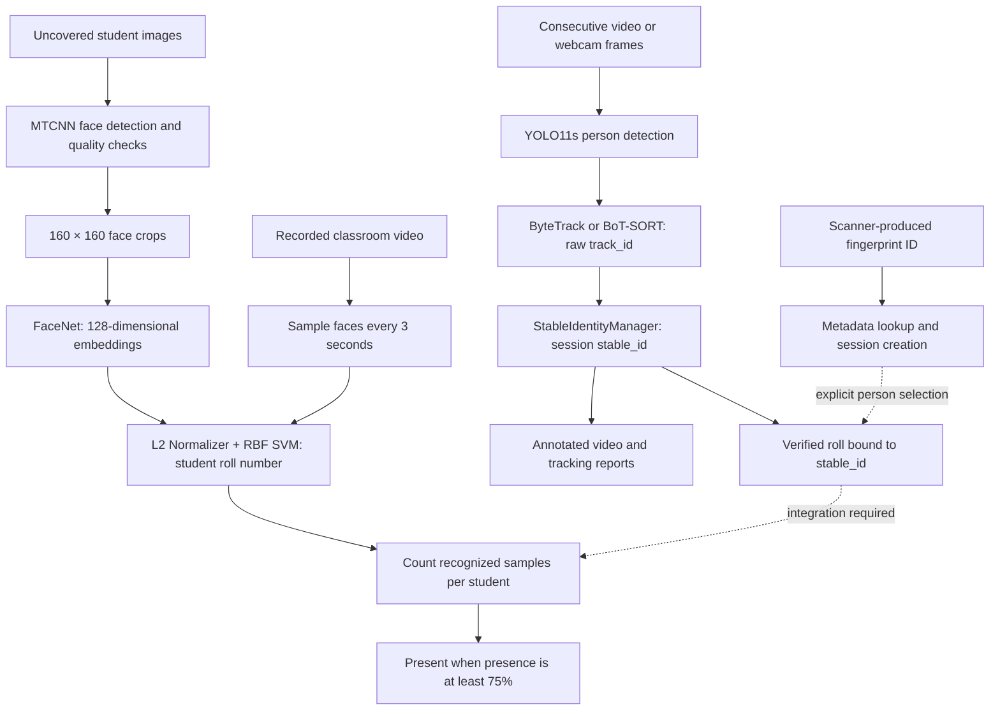

# SmartPresence

SmartPresence is a hybrid attendance research prototype combining face recognition, person tracking, fingerprint identity lookup, and presence-based attendance. Permanent student identity is a `roll_number`; a body-tracking `track_id` is temporary and does not identify a student by itself.

The repository currently provides working face-recognition tests and an independent **YOLO11s + ByteTrack/BoT-SORT** body-tracking workflow. Fingerprint/session and track-to-student mapping utilities are present, but automatic fingerprint-to-track association and a unified attendance pipeline are not yet connected.

## How the system works



Face recognition answers **who is visible** among enrolled uncovered students. Body tracking answers **which detected person continues across frames**, including people whose faces are covered. Fingerprint lookup supplies a permanent identity for the intended covered-student workflow; it does not perform biometric matching itself.

## Dataset and provenance

The student dataset was reorganized from `Data1.zip`. Rolls `22102001`–`22102040` were assigned sequentially using the original archive folder-entry order; original folder names should not be treated as the final roll mapping. See [student_folder_mapping.csv](dataset/metadata/student_folder_mapping.csv) for the authoritative source-folder mapping.

The recorded local preprocessing snapshot is:

| Group | Students | Raw images | Accepted face crops | Rejected images |
|---|---:|---:|---:|---:|
| Uncovered | 36 | 6,664 | 5,737 | 927 |
| Covered | 4 | 800 | 0 | 0 |
| Total | 40 | 7,464 | 5,737 | 927 |

The covered rolls are **22102002, 22102030, 22102031, and 22102033**, with 200 raw images each. Their images are preserved and skipped during face preprocessing, so they are neither accepted face crops nor rejections. They are absent from the saved face classifier. The body-tracking module loads pretrained YOLO weights; it does not train on these covered-student images.

Uncovered classes are imbalanced: accepted images range from 47 to 341 per student. The preprocessing report records no duplication or augmentation. Counts are documented in [dataset_summary.csv](dataset/metadata/dataset_summary.csv) and [preprocessing_report.md](outputs/reports/preprocessing_report.md); scripts discover images dynamically rather than assuming equal class sizes.

```text
dataset/
  raw/uncovered/<roll_number>/    Original uncovered images
  raw/covered/<roll_number>/      Preserved covered images
  processed/<roll_number>/       Accepted 160 × 160 face crops
  rejected/                      Failed preprocessing samples
  metadata/                      Student records and processing manifests
  test_images/single/             Inputs for numbered image-test scripts
  test_images/group/
  test_videos/
test_data/
  images/single/                  Local trained-model test inputs
  images/group/
  videos/                        Face-recognition video tests
    body_tracking/               Independent person-tracking video tests
```

Raw image names follow `<roll_number>_face_<three-digit serial>.<original_extension>`. Important metadata files include:

- `students.csv`: permanent roll number, display name, face status, fingerprint ID, dataset folder, and active state.
- `student_folder_mapping.csv`: original folder, assigned roll, and source image count.
- `face_visibility.csv`: face visibility metadata.
- `processed_images.csv` and `rejected_images.csv`: per-image processing records, including orientation recovery or rejection details.
- `dataset_summary.csv` and `preprocessing_summary.csv`: dataset and preprocessing summaries.

### Saved classifier snapshot

[model_info.json](models/classifiers/model_info.json) describes a separate Colab run dated September 3, 2026: **6,901 successful embeddings across 36 students**, split into 5,520 training and 1,381 test samples, with a 20% test split and random seed 42. The saved classifier uses a `Normalizer + SVC` pipeline with an RBF kernel, `C=10`, `gamma=scale`, and balanced class weights.

That run reports **99.49% held-out accuracy** and **99.36% macro F1**. These are saved face-classification results, not measured tracking or end-to-end attendance accuracy. Its 6,901-image manifest differs from the local 5,737-crop preprocessing snapshot; the artifacts do not establish that these are the same dataset version. Preserve the run's dataset hash and provenance when comparing results.

## Components and technologies

| Component | Technology | Purpose |
|---|---|---|
| Face detection | MTCNN | Locate faces; local inference also uses alignment |
| Face embeddings | DeepFace `Facenet`, TensorFlow / tf-keras | Convert faces into 128-dimensional feature vectors |
| Identity classification | scikit-learn SVM and label encoder | Predict enrolled student roll numbers |
| Person detection | Ultralytics YOLO11s, `models/tracking/yolo11s.pt` | Detect COCO person class 0 |
| Person tracking | ByteTrack, `config/bytetrack_smartpresence.yaml` | Temporary raw IDs with conservative stream-scoped stable IDs |
| Video and image processing | OpenCV, Pillow | Decode video, crop/resize images, draw and save results |
| Data and reports | NumPy, pandas, CSV/JSON, Matplotlib | Store observations, calculate attendance, plot results |
| Configuration and artifacts | PyYAML, joblib/pickle | Load settings and saved models |
| Fingerprint identity | CSV-backed lookup utilities | Resolve scanner-produced IDs to active students |

### Face preprocessing and recognition

1. Read uncovered raw images and student metadata. Skip covered students.
2. Detect faces using full-resolution RGB MTCNN input with a 0.90 confidence threshold, minimum 40 × 40 face size, and a 20% crop margin.
3. Apply configured blur, brightness, and multiple-face checks. Try the recorded 90° orientation fallback where applicable.
4. Resize accepted crops to 160 × 160 using aspect-preserving letterboxing; preserve rejected images and write manifests.
5. Extract FaceNet embeddings, train an SVM, and evaluate a held-out split.
6. For local inference, use aligned MTCNN detections and DeepFace `Facenet` normalization. The recognizer avoids applying embedding normalization twice when the saved pipeline already contains a `Normalizer`.
7. Return `Unknown` when the highest classifier probability is below **0.55**, a configurable prototype threshold that has not been calibrated; otherwise return the decoded roll and confidence.

The current preprocessing report records 640 no-face failures, 255 low-confidence detections, 31 undersized faces, and one ambiguous multi-face image. The orientation fallback recovered 68 images.

**Future training configuration:** processed crop → FaceNet (`normalization="Facenet"`) → 128-D embedding → sklearn L2 Normalizer → RBF SVM (`C=10`, `gamma=scale`, balanced classes, seed 42, 20% test split). Normalization of input pixels and L2 normalization of embeddings are separate operations. The existing inference logic avoids double L2 normalization. The historical Colab metadata does not explicitly record input normalization, so exact historical reproduction remains unverified. New runs preserve their dataset manifest and do not replace the imported artifacts.

### YOLO11s + ByteTrack / BoT-SORT body tracking

`track_id` is a temporary raw tracker trajectory; `stable_id` (`S001`, `S002`, ...) is a SmartPresence session-level visual continuity identity; `roll_number` is the permanent enrolled student identity. The architecture is YOLO person detection → ByteTrack/BoT-SORT → raw `track_id` → `StableIdentityManager` → `stable_id` → optional verified fingerprint/session association → `roll_number`.

Defaults are `models/tracking/yolo11s.pt`, person class `0`, detector confidence `0.10`, inference size `960`, and `config/bytetrack_smartpresence.yaml`. Low-confidence detections reach the tracker for recovery. Both custom backends use high/low/new thresholds `0.45/0.10/0.55`, buffer `120`, match threshold `0.80`, and score fusion. BoT-SORT additionally uses fixed-camera `gmc_method: none`, proximity `0.50`, appearance `0.85`, `with_reid: true`, and `model: auto`. The tested backend is pinned to Ultralytics **8.4.138**. Model paths remain configurable; bare names use existing `models/tracking/` weights when available. `--require-local-model` rejects missing detector weights before construction, which prevents a detector download attempt. Otherwise Ultralytics may download recognized missing weights online; loading failures are reported with an explicit `--model models/tracking/yolo11n.pt` fallback suggestion. There is no silent fallback.

Every consecutive frame is processed with `persist=True`. One model and one stable manager live throughout each video/webcam session; both reset only between independent streams. The face-recognition 3-second/180-second observation intervals do not apply to tracking.

The manager retains lost candidates for 120 frames, checks time, position, size, IoU, bounded motion, and optional appearance history, and requires a unique match in both directions. All gates are explicit in `STABLE_IDENTITY`. The independent SmartPresence appearance encoder is an L2-normalized HSV torso descriptor with cosine similarity and recent history, not a learned person-ReID model. BoT-SORT's separate native-feature ReID runs inside Ultralytics; SmartPresence does not read private feature hooks. With no usable appearance, only a stricter short-gap geometry fallback is allowed. Ambiguous matches receive new stable IDs.

Each observation retains `track_id` and includes `stable_id`, nullable `roll_number`/`session_id`, confidence, and box coordinates. Annotation distinguishes `S003 | T19 | 91.0%` from a verified `22102030 | S003 | 91.0%`. New recorded runs go to `outputs/tracking/runs/<run-id>/` or a fresh `--output-root`:

- `videos/<video>_tracked.mp4` and `frames/`: annotated video and snapshots.
- `reports/<video>_tracking_log.csv`: per-frame raw/stable/student fields.
- `reports/<video>_track_summary.csv`: preserved raw summary format.
- `reports/<video>_stable_identity_summary.csv`: stable visibility, raw history/change count, optional student identity, final active/inactive state; `_stable_summary.csv` remains an alias.
- `reports/<video>_continuity_report.csv` and `_continuity_statistics.json`: descriptive fragmentation, gap, visible-duration, and processing-speed statistics.
- `run_config.json`: effective run configuration and backend version.

Historical outputs are preserved; existing reports/videos are never overwritten. Visible duration counts only observed frames, not gaps. Webcam mode preserves state and provides preview without CSV export.

Raw IDs can still change. Stable IDs reduce dependence on those IDs but cannot guarantee continuity after full occlusion, long disappearance, leaving the field of view, detector failure, similar-looking people crossing, severe pose changes, lighting changes, very small boxes, or long-interval re-entry. No raw or stable ID implies a roll number. Conservative matching prefers false splits over false merges. **Tracking continuity statistics are descriptive and do not represent IDF1, HOTA, MOTA, or identity accuracy.**

The older `CoveredFaceTracker` remains an OpenCV HOG/centroid baseline used by scripts 09/10. See [the tracking design and audit](docs/tracking_identity_continuity.md) and [implementation/validation report](docs/tracking_implementation_report.md).

### Fingerprint, sessions, and identity association

`FingerprintDatabase` validates the static `fingerprint_database.csv` against authoritative `students.csv` metadata. `verify_fingerprint()` returns a structured identity with a `verified` flag, or a failure reason. Unknown IDs and inactive records cannot create sessions through the demo. Fingerprint template IDs are simulated labels; no templates enter FaceNet or YOLO.

`start_session()` creates a UUID and appends an entry record to `attendance_logs/session_records.csv`; `record_exit()` appends an exit record. `IdentityMapper.associate()` can hold a mapping of track ID to roll number, session, entry time, and face status in memory. The legacy API is retained for compatibility. For the new tracker, use `tracker.identity_manager.associate_verified(stable_id, verification_result, session_id)` after explicitly selecting the correct visible person. The manager delegates verified bindings to `StableIdentityMapper` and keeps them on the stable identity through accepted raw-ID changes. It binds the supplied verified `roll_number` to the stable ID, rejects conflicting bindings, and never derives a roll from a visual ID. Manager reset clears all bindings at a new stream; standalone mappers must also be replaced. The simulated verification result is not an authentication credential; automatic person selection and persistent mapping still require integration.

Despite its name, `scripts/10_run_full_system.py` currently performs only fingerprint-ID lookup and session creation. It does not launch recognition, tracking, or final attendance calculation.

### Static Fingerprint Demonstration

Fingerprint IDs `FP001`–`FP040` simulate successful scanner-produced IDs, each deterministically mapped to one enrolled student. The 40 records in `dataset/metadata/fingerprint_database.csv` are generated from `students.csv`, with template labels `T001`–`T040` and simulated finger `right_index`. The database validates the exact identity ranges, unique IDs, statuses, and face-status agreement before lookup. Input is trimmed and converted to uppercase.

This **simulated fingerprint verification** demonstrates identity association and informational routing only. No fingerprint image matching is performed; hardware biometric acquisition is outside this prototype stage. It does not measure fingerprint recognition performance or launch either vision branch.

```text
FP030 → 22102030 → Covered   → YOLO + ByteTrack
FP017 → 22102017 → Uncovered → FaceNet + SVM
```

```bash
# Interactive demo:
python scripts/test_static_fingerprint.py
# Direct lookup (no session is created by default):
python scripts/test_static_fingerprint.py FP030
# Optionally append a session using the existing session manager:
python scripts/test_static_fingerprint.py FP030 --create-session
# Failure example:
python scripts/test_static_fingerprint.py FP999
```

Unknown and empty IDs return `NOT VERIFIED`; inactive records return `Student fingerprint record is inactive`. Neither creates a session. Exit codes are 0 for verified, 1 for unsuccessful verification/cancellation, and 2 for configuration or file errors. Session creation appends to `attendance_logs/session_records.csv` and preserves existing entries.

To explicitly regenerate the static mapping after an authoritative metadata change (this replaces the generated CSV):

```bash
python -c "from src.fingerprint.fingerprint_database import generate_fingerprint_database; generate_fingerprint_database()"
```

### Attendance calculation

The face-video test computes:

```text
presence percentage = recognized sampled frames / total scheduled sampled frames × 100
Present if presence percentage >= 75%; otherwise Absent
```

For example, 15 recognized samples out of 20 gives 75% and is marked Present. A student is counted at most once per sample, even if duplicate face predictions appear. Unknown predictions do not count. Failed frame reads still remain in the scheduled-sample denominator.

`scripts/test_video.py` samples every 3 seconds and writes `outputs/attendance/frame_presence_log.csv`, `final_attendance.csv`, and presence charts, plus marked videos in `outputs/videos/`. The output video repeats annotated sampled frames between sampling points. Its report includes all 40 rolls, but covered students cannot be recognized by the 36-class model and therefore receive no face-based presence credit. This report is not yet a combined covered/uncovered attendance result.

The separate session-based calculator groups `attendance_logs/presence_log.csv` by session and roll, divides the sum of `observed` by the number of logged rows, and writes `attendance_logs/final_attendance.csv`. Its `presence_percentage` field is a fraction from 0 to 1. Callers must log both observed and unobserved opportunities for a meaningful denominator; logging only positive sightings yields 100%. The body tracker does not automatically populate this log.

## Installation and running

Run commands from the project root:

```bash
python -m venv .venv
source .venv/bin/activate
pip install -r requirements.txt
```

Requirements include `scikit-learn==1.6.1` for the saved classifier. Model loading may need network access if required pretrained assets are not already cached. Use `--no-preview` for recorded body-tracking runs without a graphical display.

### Test the existing face model

Place inputs in the corresponding `test_data/` directories shown above, then run:

```bash
python scripts/check_model.py
python scripts/test_single_image.py
python scripts/test_group_image.py
python scripts/test_video.py
```

Image tests save annotated results and CSV reports under `outputs/`; `outputs/reports/test_config.json` records inference settings.

### Test body tracking

Place `.mp4`, `.avi`, `.mov`, or `.mkv` files in `test_data/videos/body_tracking/`:

```bash
python scripts/08_test_body_tracking.py --no-preview
# Explicit tuned ByteTrack:
python scripts/08_test_body_tracking.py --tracker bytetrack --no-preview
# BoT-SORT with backend native-feature ReID:
python scripts/08_test_body_tracking.py --tracker botsort --no-preview
# Explicit model and detector settings:
python scripts/08_test_body_tracking.py --tracker bytetrack --model models/tracking/yolo11s.pt --imgsz 960 --conf 0.10 --no-preview
# Local-only detector loading and explicit smaller CPU fallback:
python scripts/08_test_body_tracking.py --model yolo11n.pt --imgsz 640 --require-local-model --no-preview
# Optional CPU thread limit (no model or threshold change):
python scripts/08_test_body_tracking.py --tracker botsort --cpu-threads 1 --no-preview
# Optional bounded diagnostic; no frame skipping within this prefix:
python scripts/08_test_body_tracking.py --tracker botsort --max-frames 300 --no-preview
# Disable only SmartPresence appearance (backend ReID follows its YAML):
python scripts/08_test_body_tracking.py --tracker botsort --disable-appearance --no-preview
# Raw-only diagnostic mode:
python scripts/08_test_body_tracking.py --disable-stable-id --no-preview
# Show the recorded-video preview; press Q to stop:
python scripts/08_test_body_tracking.py --preview
# Live webcam preview:
python scripts/08_test_body_tracking.py --camera --camera-index 0 --tracker botsort
```

### Run preprocessing and research training

Preprocessing still replaces its local processed dataset and reports when explicitly invoked; archive a dataset version first. Future embedding, training, and evaluation commands reserve new run directories and refuse reused IDs. No retraining happens during validation or installation.

```bash
python scripts/01_preprocess_dataset.py
python scripts/02_extract_embeddings.py --run-id embeddings_example
python scripts/03_train_model.py --embeddings experiments/embeddings_example/embeddings.pkl --run-id training_example
python scripts/04_evaluate_model.py --training-run experiments/training_example --run-id evaluation_example
```

Training saves its classifier, encoder, exact split and provenance under `experiments/<run_id>/`; evaluation reads the selected training run and writes a separate new run. See [experiments/README.md](experiments/README.md) for the manifest schema and historical dataset distinctions. Existing inference commands continue to use the imported artifacts in `models/`.

### Supporting entry points

```bash
python scripts/05_test_single_image.py dataset/test_images/single/example.jpg
python scripts/06_test_group_image.py dataset/test_images/group/example.jpg
# Frame-sampling demonstration only; its callback does not run recognition:
python scripts/07_test_video.py dataset/test_videos/classroom.mp4 --mode experiment
# Calculate attendance from an already-populated session presence log:
python scripts/09_calculate_attendance.py
# Older HOG/centroid tracking baseline:
python scripts/10_run_covered_face_tracking.py dataset/test_videos/classroom.mp4
# Fingerprint lookup and session creation only:
python scripts/11_start_fingerprint_session.py FP001
```

## Configuration and repository layout

`config/paths.yaml` defines dataset, metadata, model, and test-input paths. `config/settings.yaml` contains:

| Setting | Default | Used by |
|---|---|---|
| `ATTENDANCE_THRESHOLD` | 0.75 | Session attendance decision |
| `EXPERIMENT_FRAME_INTERVAL_SECONDS` | 3 | Generic recorded-video sampler |
| `REALTIME_CCTV_FRAME_INTERVAL_SECONDS` | 180 | Generic realtime sampler/camera callback |
| `TRAIN_TEST_SPLIT` / `RANDOM_STATE` | 0.20 / 42 | Local training |
| `TESTING.unknown_confidence_threshold` | 0.55 | Local face inference |
| `TESTING.video_frame_interval_seconds` | 3 | Local face-video test |
| `TESTING.attendance_threshold` | 0.75 | Local face-video attendance |
| `TRACKING.model` / `TRACKING.tracker` | `models/tracking/yolo11s.pt` / `config/bytetrack_smartpresence.yaml` | Body tracker |
| `TRACKING.confidence_threshold` / `inference_size` | 0.10 / 960 | Person detection |

The generic and local-testing sampling/attendance keys share YAML anchors in `config/settings.yaml`; validation checks that they agree. `TRACKING.sample_frame_count` is currently not read by the runner; example frames are selected explicitly in its code.

- `src/`: reusable preprocessing, recognition, tracking, fingerprint, attendance, video, and utility modules.
- `scripts/`: research steps and local testing commands.
- `models/`: embeddings, classifier, encoder, provenance, and tracking weights.
- `experiments/`: saved experiment configurations, metrics, and classification reports.
- `outputs/`: reports, figures, annotated images/videos, attendance, and tracking results.
- `attendance_logs/`: session and presence records plus session-based attendance output.
- `tests/`: core configuration and identity tests; run `pytest tests/`.
- `notebooks/`: analysis workspace. Publication figures belong in `outputs/figures/paper/`, derived from saved results and exported on a white background at 300 DPI.

See [migration_report.md](outputs/reports/migration_report.md) for the legacy-data audit. Current remaining work is hardware fingerprint integration, reliable student-to-track association, ground-truth validation of tracking recovery, and orchestration of both vision branches into session attendance. Existing classification metrics do not validate those unfinished stages.

## Reproducibility

Use Python 3.11 for the research runtime; install with `python -m pip install -r requirements.txt` in a fresh virtual environment. Keep `scikit-learn==1.6.1` for serialized model compatibility. `config/settings.yaml` and `config/paths.yaml` are authoritative configuration; actual dependency versions are captured in every future run manifest. `environment_versions.json` records only the cleanup test environment, not the unknown historical Colab environment. It is not a full model-runtime lockfile.

The model is a **36-class FaceNet-SVM recognition model within a 40-participant SmartPresence evaluation**. Fingerprint lookup is simulated; face recognition, independent body tracking and attendance calculations are implemented prototype components. Their automatic identity association and hardware integration remain future work.

```bash
python scripts/validate_research_repository.py
pytest -q
python -m compileall -q src scripts
python scripts/research_status.py
```

Training/evaluation, inference, tracking and static fingerprint commands are listed above. The preferred numbered sequence uses `09_calculate_attendance.py`, `10_run_covered_face_tracking.py` (legacy baseline), and `11_start_fingerprint_session.py`. Historical `08_calculate_attendance.py`, `09_run_covered_face_tracking.py`, and `10_run_full_system.py` remain compatible. `12_run_full_system.py` is an explicit session-initialization alias, not an integrated pipeline.

For future threshold calibration, provide independent known/unknown validation-score CSVs with a `confidence` column to `python scripts/evaluate_unknown_threshold.py --known known.csv --unknown unknown.csv`. This reports face known/unknown acceptance trade-offs, not correct student-identification accuracy, and never changes the configured 0.55 threshold. Without both datasets it exits without calibration.

Research training/evaluation outputs use fresh directories. Existing face-inference demos retain their established output locations and may overwrite demo reports. Tracking now reserves fresh run directories and refuses existing output files. Do not treat demo output as immutable final results.

See [model documentation](models/README.md), [privacy review](DATA_PRIVACY.md), [license decision](LICENSE_RECOMMENDATION.md), and the [submission checklist](docs/JOURNAL_REPRODUCIBILITY_CHECKLIST.md). Ignore rules do not remove the 6,901 processed images already tracked by Git. Review permission and repository history before publication. No code license or ethics approval is asserted by this cleanup.
